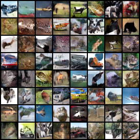
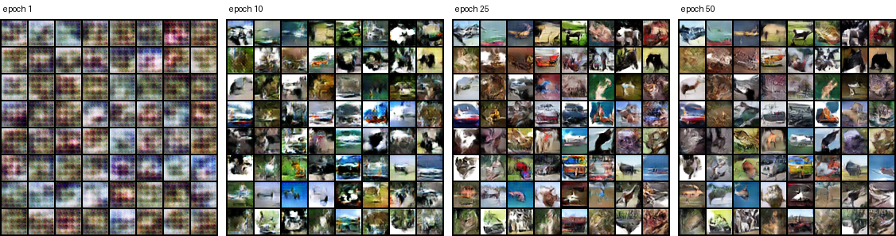
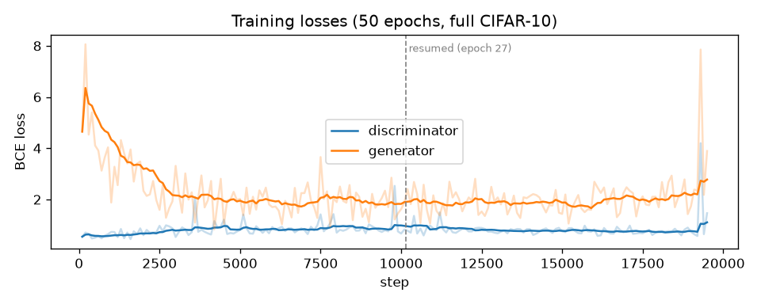

# DCGAN from Scratch (PyTorch)

A small, readable DCGAN for 32×32 color images (CIFAR-10), written from scratch in PyTorch: generator, discriminator, numerically stable losses, a training loop with TensorBoard logging and checkpoints, and FID / Inception Score evaluation. The code favors clarity: tensor shapes and the reason behind each stability trick are documented next to the line that applies them.



*64 samples from the same fixed noise after 50 epochs on CIFAR-10 (no class conditioning).*

## Results

| Setting | Value |
|---|---|
| Data | CIFAR-10 train set, all 50,000 images, 32×32 |
| Training | 50 epochs (19,500 steps), batch 128, Adam lr 2e-4 (β₁ 0.5), label smoothing 0.1 |
| Hardware / time | Apple M-series GPU (MPS), ~36 s per epoch, ~30 min in total |
| **FID** ↓ | **43.96** (10k generated vs. 10k real images) |
| **Inception Score** ↑ | **6.19 ± 0.11** (10 splits) |

Metrics use the standard `inception-v3-compat` weights from torch-fidelity; on a 192-image check, FID matches torchmetrics exactly. Fewer real images give a slightly higher FID, so compare numbers computed with the same sample sizes.



*Fixed-noise samples at epochs 1, 10, 25 and 50: color blobs, then rough shapes, then recognizable cars, horses, birds and ships.*



*Discriminator and generator losses (smoothed). The run was paused after epoch 26 and resumed from the checkpoint with no jump in either loss. The short generator spike near the end is a normal GAN fluctuation.*

## Architecture

| | Generator | Discriminator |
|---|---|---|
| Input | z ∈ ℝ¹²⁸, shape `[B, 128, 1, 1]` | image `[B, 3, 32, 32]` in [-1, 1] |
| Body | 4 × ConvTranspose2d (4×4): 1→4→8→16→32 px, BatchNorm + ReLU | 3 × Conv2d (4×4, stride 2): 32→16→8→4 px, LeakyReLU(0.2), BatchNorm on all but the first; then a 4×4 conv to 1×1 |
| Output | Tanh → `[B, 3, 32, 32]` | one logit per image (no sigmoid) |
| Width | 256 → 128 → 64 channels | 64 → 128 → 256 channels |

## Stability choices

- **`BCEWithLogitsLoss`** instead of sigmoid + BCE: one fused, numerically stable operation.
- **One-sided label smoothing** (real targets 0.9): keeps the discriminator from becoming overconfident.
- **DCGAN initialization** (N(0, 0.02) weights, BatchNorm γ ~ N(1, 0.02)) and **Adam with β₁ = 0.5**, as in Radford et al. (2015).
- **`fake.detach()`** in the discriminator step, so its update never flows into the generator.
- **`drop_last=True`**, so BatchNorm always sees full batches.
- **Fixed noise** for sample grids, so progress is visually comparable across epochs.

## Quick start

```bash
python -m venv .venv && source .venv/bin/activate
pip install -r requirements.txt

python train.py --epochs 20 --subset-size 10000     # CIFAR-10 downloads automatically into ./data
tensorboard --logdir runs                            # losses + sample grids

python train.py --epochs 50 --resume runs/<run>/checkpoints/gan_epoch_026.pt   # continue a stopped run

python -m metrics.compute_metrics --ckpt runs/<run>/checkpoints/gan_epoch_050.pt
```

`compute_metrics` runs Inception-v3 once per image for both FID features and Inception Score logits, prints progress with time left, and caches the real-image statistics in `metrics/cache/`, so later evaluations only process generated images. It runs on CUDA or CPU (~9 images/s on an Apple laptop CPU).

`train.py` picks CUDA, Apple MPS or CPU automatically; on MPS it loads data in-process (`--num-workers 0` by default), because worker processes stalled training there. Useful flags: `--batch-size`, `--lr`, `--z-dim`, `--label-smoothing`, `--subset-size` (pass `50000` for the full training set).

## Project structure

```text
models/generator.py, models/discriminator.py   networks + DCGAN init
losses/gan_loss.py                             D and G losses (BCE with logits, label smoothing)
datasets/cifar_like.py                         CIFAR-10 loader, normalization to [-1, 1], deterministic subset
trainer/gan_trainer.py                         training loop, TensorBoard, sample grids, checkpoints, resume
metrics/compute_metrics.py                     FID and Inception Score (single Inception pass, cached real stats)
train.py                                       entry point / CLI
docs/README_TR.md                              original long-form tutorial (Turkish)
```

## License

MIT. See [LICENSE](LICENSE).
